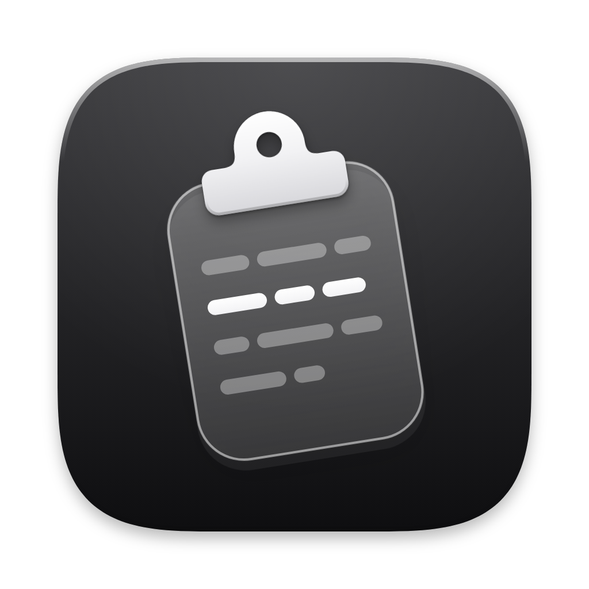
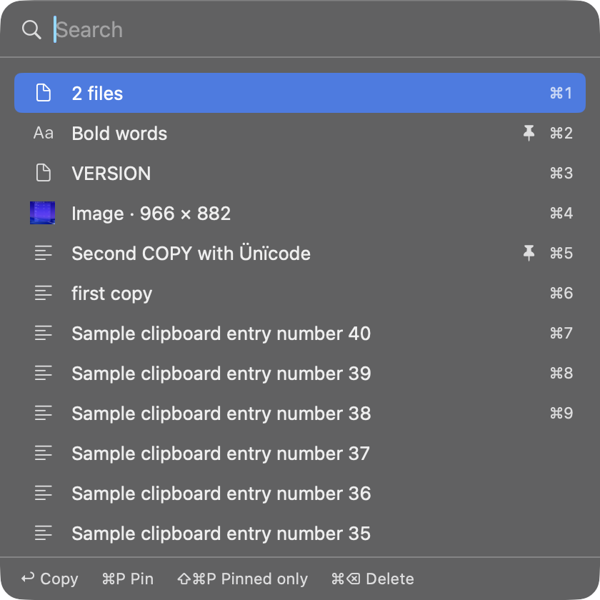

# Klip



**A simple clipboard manager for macOS.**

Native Swift and AppKit. Lives in the menu bar.

[Download for macOS](https://github.com/rengwu/klip/releases/latest/download/Klip.zip)



<br clear="right">

## Features

- Keeps text, rich text, images and file references
- **⇧⌘V** opens a searchable panel; **Return** pastes into the app you were in
- Highlighting an image shows a larger preview beside the panel
- **⌘1–⌘9** paste directly, **⌘P** pins, **⇧⌘P** shows pinned only, **⌘⌫** deletes
- History decays after 7 days (up to 30) and is capped at 500 MB; both are configurable
- Skips copies that password managers mark as concealed

## Install

1. [Download Klip.zip](https://github.com/rengwu/klip/releases/latest/download/Klip.zip) and unzip it.
2. Move **Klip** into **Applications** and open it.
3. To paste directly into apps, open Klip's Settings and allow it under Accessibility.
   Without that, Return copies the item and you press ⌘V yourself.

Requires macOS 13 or later, on Apple Silicon or Intel. The app is ad-hoc signed, not
notarized. If macOS blocks it, use **System Settings → Privacy & Security → Open Anyway**.

## Build

Requires Xcode Command Line Tools.

```sh
swift run KlipCoreTests   # tests
./build.sh                # build/Klip.app
```

Design decisions and validation are in [the project wiki](docs/wiki/index.md).
