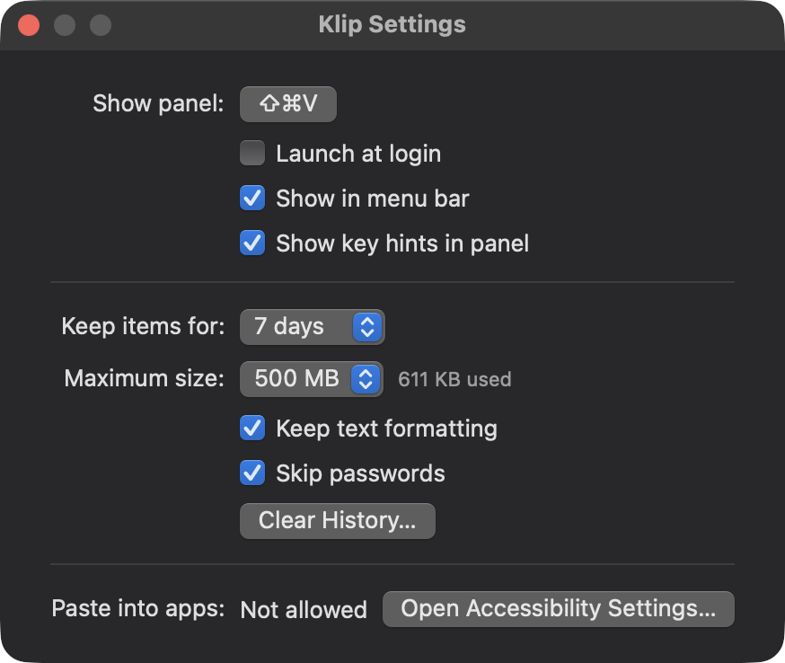
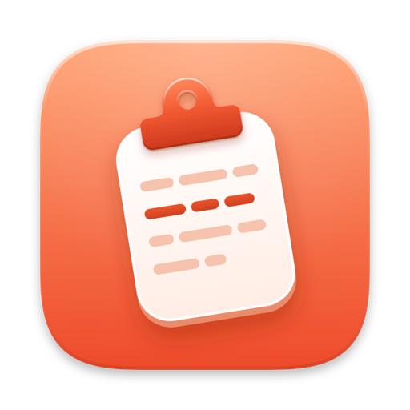

# Implementation and validation

Version 0.1.0 is built to the [plan](plan.md). The project is not under version control, so there is no revision to cite; this page describes the files as they stood on 2026-11-15.

## Build and run

Requires Xcode Command Line Tools; full Xcode is not needed.

```sh
swift run KlipCoreTests   # core tests
./build.sh                # universal, ad-hoc-signed build/Klip.app
```

Data lives in `~/Library/Application Support/Klip/`: `config.json`, `history.sqlite`, and `images/`. Setting `KLIP_HOME` points a run at another directory. `KLIP_SHOW=panel` or `KLIP_SHOW=settings` opens that window at launch, for checking a build without the global shortcut.

## Structure

| Part | Role |
| --- | --- |
| `Sources/KlipCore/Store.swift` | History in SQLite through the system `libsqlite3`; image payloads as PNG files. Duplicates, search, paging, decay, size eviction. |
| `Sources/KlipCore/AppConfig.swift` | Settings and their defaults, stored as JSON. |
| `Sources/KlipCore/Model.swift` | Item kinds, captures, row titles. |
| `Sources/Klip/Clipboard.swift` | Reads copies from the pasteboard, writes items back, sends ⌘V. |
| `Sources/Klip/HotKeyCenter.swift` | The global shortcut through Carbon hot keys. |
| `Sources/Klip/PanelController.swift` | The panel: search field, list, key handling, paging. |
| `Sources/Klip/SettingsWindowController.swift` | The Settings window. |
| `Sources/Klip/AppDelegate.swift` | Wiring, the pasteboard poll, the menu bar item. |

KlipCore has no AppKit dependency. There are no third-party packages.

## How it works

- The pasteboard has no change notification, so Klip compares its change count every 0.4 s.
- The panel is a non-activating `NSPanel`. It takes the keyboard without making Klip the active app, so the app the user was in stays frontmost and receives the paste.
- The list loads 50 items, and the next 50 when the scroll position or the highlight nears the end.
- Search lowercases both sides in Swift and matches with SQLite `instr`, because SQLite's `LIKE` ignores case only for ASCII.
- A repeated copy is recognized by a SHA-256 of its kind and content. Formatting is not part of identity: the newest copy decides whether an item carries it.
- Decay and the size limit are applied after every save, every five minutes, and when a setting changes.

## Validation

Tested on macOS 27.0 (arm64), Swift 6.4.2, against an isolated `KLIP_HOME`.

**Core tests:** `swift run KlipCoreTests` passed, 47 of 47. They cover ordering, repeated copies, paging, search (case, non-ASCII, literal wildcards, file paths, images), titles, formatting replacement, decay with pins, eviction order, the 10% item cap, image files, delete, clear, persistence across reopen, and settings defaults and round-trip.

**Built app, observed:**

| Scenario | Result |
| --- | --- |
| `./build.sh` produces a signed universal app | Passed: `x86_64 arm64`, signature verified |
| Text copies are captured | Passed |
| Copying the same text again moves it to the top, without a second row | Passed |
| A PNG image is captured with its dimensions and a file under `images/` | Passed |
| A copy marked `org.nspasteboard.ConcealedType` is skipped | Passed |
| One file and two files copied are stored as paths | Passed |
| Text with RTF is stored as rich text with its RTF | Passed |
| The panel shows rows aligned across kinds, pins, ⌘1–⌘9, the footer | Passed: [screenshot](attachments/2026-11-15-panel.png) |
| The panel updates while open as new copies arrive | Passed |
| Settings shows every control, and the Accessibility row while permission is missing | Passed: [screenshot](attachments/2026-11-15-settings.png) |




**Untested.** The agent could not send keystrokes to the app: the terminal lacks the Accessibility permission. These need a person at the keyboard:

- The global shortcut opening and closing the panel
- Typing in the search field, ↑ ↓, Return, Esc, clicking a row
- ⌘P, ⇧⌘P, ⌘⌫, ⌘1–⌘9, ⌘,
- Pasting into the previous app once Accessibility is granted
- Loading further pages while scrolling past 50 items
- Recording a new shortcut, launch at login, hiding the menu bar icon, Clear History
- Appearance in light mode, and on a second display

## Icon

The first icon was a clipboard character with a face, chosen from [four directions](journal/2026-11-15-grill-10db2c85deb2f154ccc00ce2e9b27e8b.md). The menu bar outline matched it, without the squircle. On 2026-11-19 the user asked for a logo with no eyes and no personified characters. After trying other directions, they had the current icon refined instead and approved it over [three review rounds](journal/2026-11-19-grill-icon-redesign.md).

What the refined icon keeps:

- the orange squircle
- the white board
- the orange clip
- the slight tilt

What it changes:

- Four lines of text, broken into words, replace the face. The second line is set in Klip's orange, with nothing behind it.
- The clip is one silhouette: a plate gripping the board's top edge rises through curved corners into an arched tab. The hole in the tab shows the background, and the clip's highlight follows its outline.
- The outline uses Apple's icon shape: straight sides with continuous corners.
- A light rim runs around the edge, and the board shows its edge, so it looks thick.

The menu bar glyph matches: the same tilted board outline, the icon's clip silhouette with its hole, and three lines of text getting shorter.

- `Resources/AppIcon.svg` is the artwork. `Resources/make-icon.sh` renders it with a headless Chromium-based browser and builds `Resources/AppIcon.icns`, which is committed so `build.sh` needs no renderer.
- `Sources/Klip/StatusIcon.swift` draws the menu bar glyph in code as a template image.




Checked:

- The `.icns` renders as approved and still reads at 16 px.
- The glyph drawn by `StatusIcon.swift` matches the approved preview at the same size.
- The built bundle contains the new `.icns`.

Not yet looked at by the agent: the glyph in the real menu bar and the icon in Finder. Finder may show the old icon until its icon cache refreshes.

## Limits

- The build is ad-hoc signed. An ad-hoc signature is identified by its code hash, so at first every rebuild orphaned the Accessibility grant: System Settings still listed Klip as allowed while the new build was refused. `build.sh` now signs with the designated requirement `identifier "local.klip"` so the grant should follow the bundle identifier across rebuilds. That it survives a rebuild is not yet confirmed. A stale entry is cleared with `tccutil reset Accessibility local.klip`.
- History is stored unencrypted.
- A file reference is a path; it goes stale if the file moves.
- Images are written back as PNG only.
