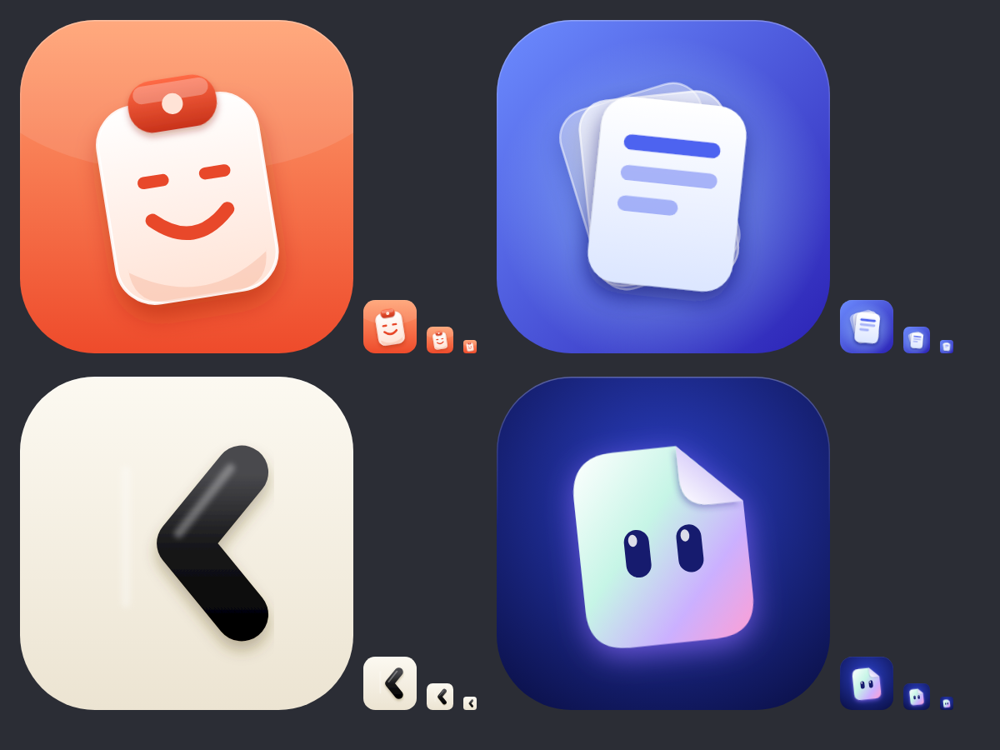

# Icon direction submitted answers

Submitted through grill-form on 2026-11-15, Fungi session `10db2c85deb2f154ccc00ce2e9b27e8b`.

The user asked for an app icon and gave three references: appicons.store, dribbble.com/ktnr/shots and icon.museum. The agent could view images only from the first; the other two yielded titles and tags. The four sketches follow that first reference: one bold subject on a saturated squircle, with soft depth, gloss and mascot touches.

In the image, the first sketch of the K mark is missing its stem; that was fixed before the form was shown.

| # | Question | Answer | Notes |
| --- | --- | --- | --- |
| 27 | Which icon direction should we take forward? | A: Clipboard pal — a tilted clipboard with a face | |
| 28 | Should the menu bar icon change too? | Draw an outline that matches the chosen icon | “the outline only includes the [Image #1], the squircle can be ignored.” The pasted image showed the clipboard character alone. |

The outcome is in [implementation and validation](../implementation.md#icon).
