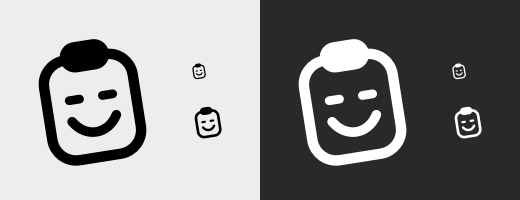

# Icon redesign rounds

On 2026-11-19 the user asked for a new logo. The reference was katyaneray's work on Contra, with one rule: no eyes and no personified characters. The rounds followed jstack's `visual-spikes` workflow: four prototypes per round, shown through grill-form with a preview for each.

| Round | Fungi session | Shown | Answer |
| --- | --- | --- | --- |
| 1 | `6eaa11864915dc2d779fe440af8364f9` | Four directions from the Contra reference | None chosen. “try again, new ref: https://icon.museum/” |
| 2 | `d6c57e133fd2a138c77c6ee409898c40` | Four directions from icon.museum | None chosen. “give me 4 more” |
| 3 | `3f44963586ed1ec9e088191eb8175f76` | Four more directions | None chosen. “lets just go with a clipboard, give me 4 different designs” |
| 4 | `f577bd40fbcf4de7bf644e86886efac9` | Four clipboard designs | A · Hardboard. “refine A. follow apple's native macos icons style” |
| 5 | `d74cd7b4c57de0342791d991310734d7` | The hardboard clipboard refined in Default and Dark, and a menu bar glyph without a face | Closed without submitting |

Then, in chat: “actually, just refine the current icon”. The agent took this to mean Klip's existing clipboard icon rather than the hardboard design. The face had to go, because of the rule from the start of the redesign.

The agent's first refinement was applied to the repo without a review round. The user then said: “when i say refine, i need you to approve with grill-form first. no unauthorized changes”. Those changes were reverted, and every refinement after that went through a form first:

| Round | Fungi session | Question | Answer |
| --- | --- | --- | --- |
| 6 | `49b90a9500c3679e18090f00328fc234` | Use the refined current icon? The face is replaced by text lines; the outline, rim and board edge are reworked | Refine further. The user pointed at the clip and the highlighted line: “nice but these parts can be better. i don't wanna see simple primitive shapes stacked or placed unthoughtfully” |
| 6 | | Menu bar glyph with two lines instead of a face? | Change it: “three lines instead of two?” |
| 7 | `438caba4e97ff76353526e38428dede1` | The clip redrawn as one silhouette, the highlighted line as a marker stroke, text broken into words | Refine further. The user pointed at the marker stroke: “i don't like this part. others are actually fine.” |
| 7 | | Glyph with three lines? | Change it: “make the top part's shape similar to our new icon” |
| 8 | `7c5b35f3131c7d35c480072d70c116ba` | Which highlighted line: A, orange text with nothing behind it; B, a selection band with handles; C, a strip lifted off the page? | A |
| 8 | | Glyph with the icon's clip silhouette? | Yes |
| 8 | | Apply the approved choices to Klip? | Apply |

The icon and menu bar glyph before the refinement:

The outcome is in [implementation and validation](../implementation.md#icon).
